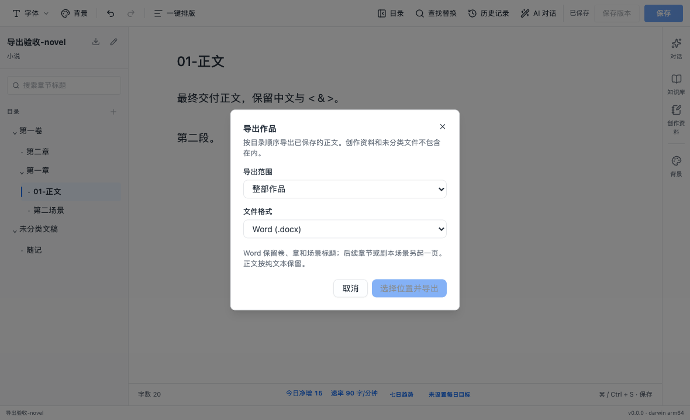
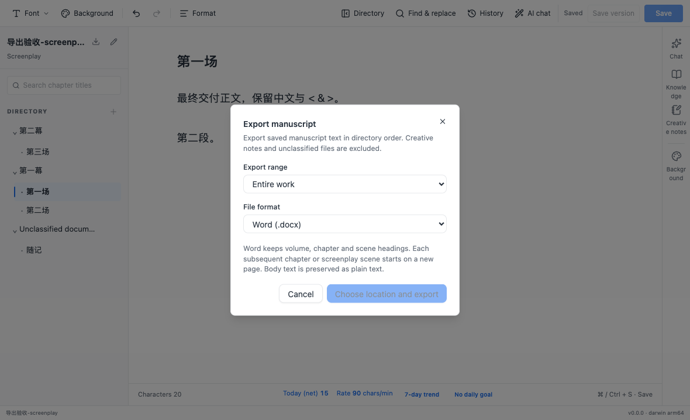

# 作品导出

## 用户行为

作品编辑页左侧标题旁新增下载图标，打开“导出作品”。选择整部作品或当前章节 / 场景，支持 TXT、Markdown 和 Word（DOCX），默认选中整部作品和 Word。点击“选择位置并导出”后，通过系统保存对话框选择文件；覆盖已有文件使用系统确认。

小说当前章节包含本章所有场景；剧本当前范围只包含正在编辑的场景。没有打开已识别正文时，当前范围禁用。整部作品严格沿用目录顺序，保留作品名、卷、章和场景标题，去掉导入时的四位排序前缀，省略默认“01-正文”占位标题。未分类文稿、创作资料、对话、版本数据和其他辅助文件不导出。

有未保存正文时，弹窗提示先保存并提供保存按钮；保存失败时在弹窗内显示错误，继续保留草稿。取消弹窗或系统保存对话框不会修改正文。完成后，底部状态栏显示文件名及文稿数量。

## 格式与边界

TXT 和 Markdown 按顺序合并标题及原始正文，以 UTF-8 写入；Markdown 标题带层级，正文保留原有标记。Word 使用 A4 页面、分级标题和正文段落，后续章节或剧本场景另起一页，新卷 / 幕从新页开始并与首章 / 场景标题保持相邻。Word 正文按原始文字保留，不把 Markdown 标记转换成富文本。

一次最多导出 20 MiB 原始正文及标题、2,000 篇文稿、100,000 行；超过限制时提示按章节导出。空作品提示没有可导出的正文。TXT、Markdown 和 Word 的生成均在后台线程运行，设置 30 秒超时和 256 MiB JavaScript 堆限制。首版没有 PDF、EPUB、批量分文件或自定义交稿模板。

## 实现与安全

新增严格类型化的 `project:export` IPC，请求只接受作品 ID、格式、范围和界面语言，不接受目标路径。主进程校验可信主框架、请求参数数量及作品标签归属；同一标签只允许一个导出请求，系统对话框返回后再次校验归属。绝对路径与文稿快照保留在主进程，响应只包含文件名和数量。

读取正文复用注册作品根路径及路径授权规则，按作品操作队列获取已保存内容快照，并遵守现有 Agent 互斥。拒绝符号链接读取，限制读取量，检查文件读取前后及快照完成时的大小、时间和文件身份；无效 UTF-8 或 XML 不允许的控制字符会停止导出。目录扫描中原本不识别的符号链接继续排除。

输出位置禁止位于任何已登记作品目录内，禁止覆盖符号链接、目录或扩展名不符的文件。输出使用现有原子写入工具（增加二进制内容支持），生成失败保留旧交稿文件，临时文件清理后才返回错误。发布前检查目标文件是否被外部创建或修改，并检查所选父目录是否被重定向。

新增桌面端运行依赖 `docx@9.11.0`，只用于后台线程的 Word 生成。Electron 构建增加独立导出线程入口；应用使用本地文件生成，无联网或平台账号依赖。锁文件保留原有依赖版本，只增加所需依赖。

## 验证

- 本机 macOS arm64 上 `pnpm verify` 返回 0：格式、边界、全仓 lint、类型检查、测试、构建和 Electron 全套回归通过。Desktop 270 项、Contracts 56 项、Project Schema 8 项通过；Electron 29 项通过、1 项平台场景按配置跳过，API 4 项通过、8 项 MongoDB / Redis 集成测试按默认配置跳过。保留既有 4 条 Fast Refresh warning，无新增 lint error。
- 使用 Node.js 24.21.0、pnpm 11.7.0 和内置 Python 3.12.14；全仓检查日志保留在 `/tmp/author-copilot-export-verify.log`。`pnpm install --frozen-lockfile` 已验证锁文件可用。

- Desktop 270 项单元测试、Contracts 56 项契约测试通过；覆盖目录顺序、章节范围、中文与特殊字符、Word 独立解析与 OOXML 标题 / 分页、后台线程输出、原子发布失败、外部目标修改、文件保护、范围限制、Agent 互斥、IPC 归属和系统取消。
- 新增两条 Electron 场景通过，分别覆盖中文小说和英文剧本：取消保留草稿、弹窗内保存、三种格式的整部和当前范围导出、顺序、正文排除规则，以及源文件内容保持正确。
- 系统保存对话框通过主进程单元测试验证选项；Electron 自动化使用固定目标目录，不自动操作系统原生覆盖确认弹窗。
- 界面截图已检查。Word 通过独立提取器和压缩包内 XML 检查，未做 Microsoft Word 客户端或 Windows 安装包验收。

