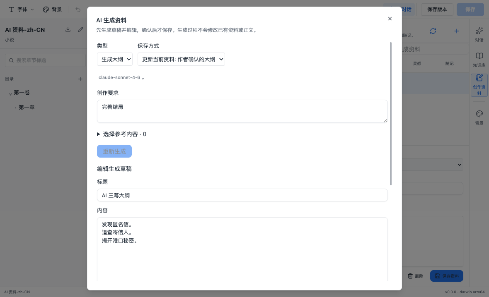
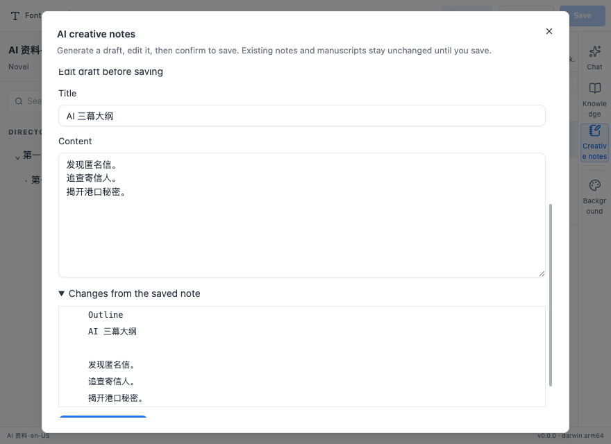

# AI 创作资料生成与确认保存

## 用户流程

创作资料面板新增“AI 生成资料”。可生成大纲、扩展灵感或整理随记，填写要求并选择已有资料与章节。不要求先打开正文；待编辑资料有未保存修改时，先保存再打开生成窗口。

生成复用当前选定的官方、自定义 Anthropic 兼容供应商或平台中转。模型只返回草稿，生成本身不会写入资料、正文、对话或 Git。草稿可编辑标题、正文和类型，可重新生成或放弃；失败、超时、停止均保留上一版草稿。确认保存后，资料接入已有管理和引用流程。

已选资料默认作为更新目标，也可改存新资料。更新前显示类型、标题和正文差异；生成前和确认保存时都检查已有资料的版本。冲突或删除不会覆盖原资料，保留草稿并允许改存新资料。生成要求和草稿接入作品标签的未保存保护；关闭生成窗口需要确认，保存期间不能关闭。草稿仅在当前页面内存保留，不提供崩溃后的草稿恢复。

## 范围与实现

- 最多引用 6 条资料、8 篇文稿，参考正文（含待更新资料）合计不超过 120,000 个 UTF-16 字符。不截断正文，超限要求减少引用。
- 主进程重新读取所选已保存资料和文稿。未选资料、未保存正文和知识索引检索结果不自动注入。缺失引用会阻止模型请求。
- 创作要求最多 4,000 字符；生成标题最多 200 字符，正文最多 100,000 字符。强制结构化工具输出并严格校验字段；该工具不具有持久化权限。
- 同一作品同时只运行一个资料生成请求，默认总时限 60 秒；不自动重试收费请求。
- 新增严格类型化 `creative-notes:generate` / `creative-notes:generate-cancel` IPC。主进程检查可信主框架及作品标签归属；取消仅允许请求所有者操作。关闭标签、页面导航、渲染进程崩溃及应用退出会撤销请求。
- 密钥和平台令牌留在主进程，不通过生成请求或结果暴露。复用已有传输与用量计费链路，不新增平台接口或依赖。
- 差异显示前 300 行并明确提示，保存使用完整编辑稿。资料沿用 `userData/creative-notes` 原子保存与时间戳冲突保护，不进入作品导出或 Git。
- 更新中英文 README、桌面说明、开发指南及当前路线图，区分已实现能力与后续愿景。

## 验证

自动化覆盖无当前正文生成、最新引用读取、未选资料排除、上下文和输出限制、失效引用、目标版本冲突、取消与超时、作品并发限制、所选供应商/平台路由，以及 IPC 来源和所有者隔离。

中英文 Electron 场景验证生成前不落盘、草稿编辑与确认、失败和停止保留原草稿、更新差异、冲突保护与改存新资料、重载持久化和放弃确认。普通与窄窗口截图用于界面检查。

模型使用本地 Anthropic 协议模拟服务，实际执行 Electron、传输、IPC 和本地保存链路；不代表真实模型创作质量。本次不包含真实模型费用、生产平台服务或 Windows/macOS 其他架构安装包验收。

### 最终结果（2026-11-06）

- 本机 macOS arm64、Node.js 24.21.0、pnpm 11.7.0、内置 Python 3.12.14：完整 `pnpm verify` 返回 0，覆盖格式、边界、全仓 lint、类型检查、单元测试、生产构建和 Electron E2E。
- Desktop 281 项、Contracts 59 项、Project Schema 8 项通过；API 4 项通过，8 项 MongoDB/Redis 集成测试按默认配置跳过。Git runtime 辅助测试和 RAG 基准测试通过。
- Electron 33 项通过，1 项依赖隔离平台服务的场景按配置跳过；新增中英文场景均通过，包含成功更新和外部更新冲突后改存新资料。
- 保留原有 4 条 Fast Refresh warning，无新增 lint error。完整日志：`/tmp/author-copilot-creative-generation-verify.log`。
- 将既有 IME E2E 的光标定位改为显式设置选区，避免 macOS End 键只滚动页面导致的前置状态不确定；未修改编辑器行为。
- 普通与窄窗口截图已检查；`git diff --check` 通过。

