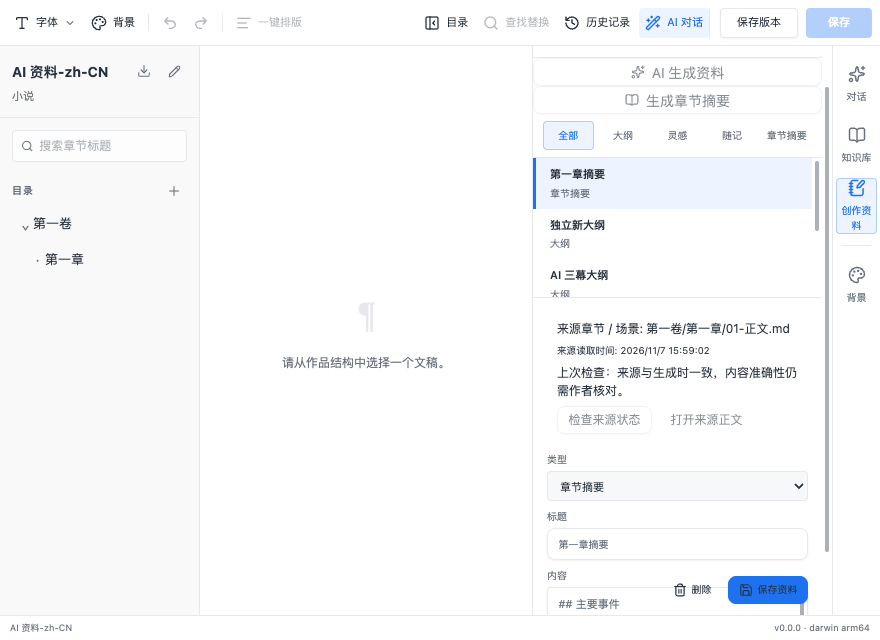
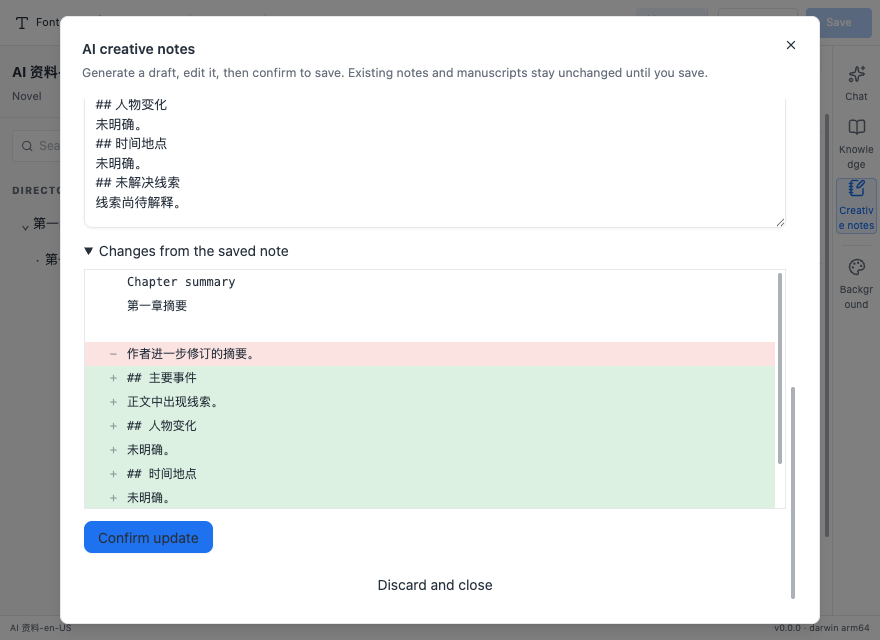

# 章节摘要交付记录

入口：“创作资料 → 生成章节摘要”。本次增加单篇章节/场景摘要、作者编辑确认、更新差异审阅、来源版本记录、过期/缺失状态检查和打开来源正文。摘要可作为现有 Ask/Agent 的资料引用，引用快照携带来源信息。

实现复用创作资料生成、取消及持久化链路。新增 `summary` 类型和强制来源字段，模型工具严格限制为标题和内容，主进程记录来源哈希；新增有作品归属检查的 `creative-notes:summary-status` IPC。渲染进程继续通过类型化 preload 工作，没有新增 Node/文件系统权限或依赖。无平台 API 和配置变更。

需求、来源状态语义和边界见[章节摘要说明](../specs/chapter-summaries.md)。每次一篇正文，不提供全书自动摘要或事实实体提取；真实模型准确性仍由作者审阅。

## 验证

- 定向单元测试覆盖来源哈希在模型请求前捕获、空章、模型伪造来源拒绝、持久化与作者编辑、更新冲突、来源变化/缺失/访问错误及跨作品 IPC 隔离。
- 契约测试覆盖唯一来源约束、资料类型与来源配对、路径穿越和哈希校验；AI 对话测试覆盖来源快照隔离。
- 中英文 Electron 场景覆盖未确认不保存、编辑保存、生成期间正文变化、来源移动、手动编辑保留来源、更新差异和来源刷新、打开原文、筛选与重载持久化。模型使用本地 Anthropic 协议模拟服务，未调用付费模型。
- macOS arm64、Node.js 24.22.2、pnpm 11.28.11、uv 0.13.7 / Python 3.14.10：完整 `pnpm verify` 返回 0，包含格式、边界、全仓 lint、类型检查、单元测试、生产构建和 Electron E2E。
- Desktop 286 项、Contracts 60 项、Project Schema 8 项通过；API 4 项通过、8 项依赖 MongoDB/Redis 的集成测试按默认配置跳过。Git runtime 和 RAG 测试通过。
- Electron 33 项通过、1 项依赖平台服务的场景按配置跳过；中英文摘要流程均通过，完整 E2E 用时 1.6 分钟。
- 保留原有 4 条 Fast Refresh warning，无新增 lint warning/error。完整日志位于 `/tmp/author-copilot-chapter-summary-verify.log`；`git diff --check` 通过。
- 已检查 880 × 640 窄窗口的来源状态和更新差异，可滚动编辑并确认。未进行真实模型质量评估、生产平台验证或其他架构发布验收。

