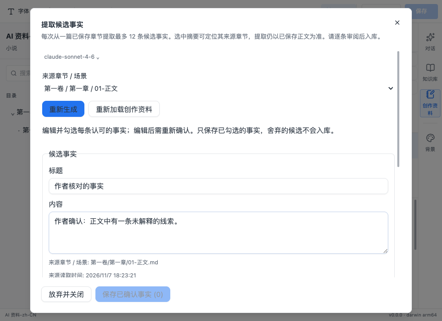
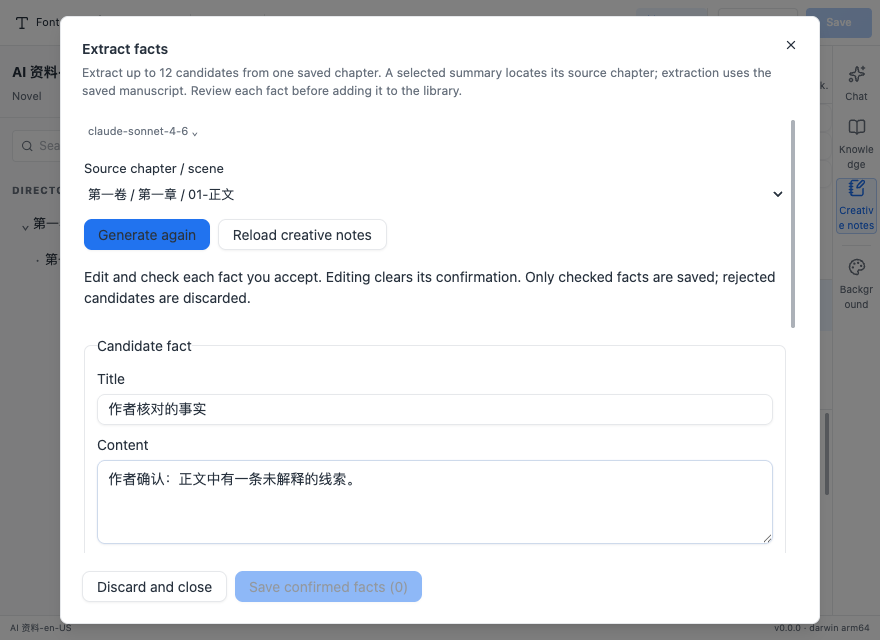
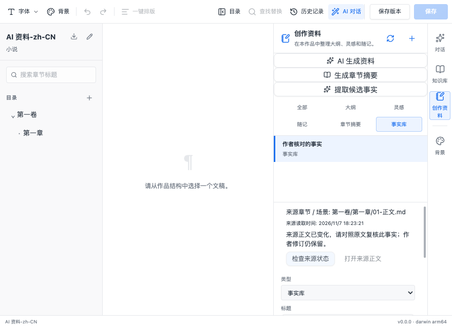

# 可修订事实库首版交付记录

入口：“创作资料 → 提取候选事实”。作者选择一篇已保存章节或场景，获得最多 12 条候选；逐条编辑、确认或舍弃后，将确认条目加入事实库。编辑会清除该条确认，未勾选候选不会保存；部分保存后其余候选仍可继续审阅。

事实支持筛选、编辑、删除、来源状态检查、打开来源正文和显式加入 Ask／Agent 引用。每条保留正文路径、SHA-256 和读取时间；正文变化或来源丢失不自动覆盖作者修订。重新提取不自动替换已有事实。需求与完整边界见[事实库说明](../specs/fact-library.md)。

## 实现影响

- 复用创作资料、供应商传输、取消、超时与持久化链路；新增 `fact` 类型和严格候选列表工具输出。主进程生成候选 ID 及来源元数据，模型不能选择这些字段。
- 增加 `creative-notes:confirm-facts`：原子批量保存、稳定 ID 重试去重、已有条目冲突保护及容量限制。事实手动编辑保留来源，禁止通过编辑请求刷新来源或移除事实类型。
- 将摘要来源检查推广为 `creative-notes:source-status`，同步更新共享契约、preload、主进程、渲染进程和测试。IPC 继续校验可信主框架及作品归属，渲染进程没有新增 Node 或文件系统权限。
- Ask 和 Agent 传递事实来源快照，提示保留作者限定条件并指出与正文的冲突；引用仍由作者显式选择。
- 新增中英文提取和审阅界面；资料筛选改为两行布局，编辑区独立滚动，避免窄窗口下正文与保存操作重叠。
- 资料沿用应用数据目录和 schema 版本 1；不纳入作品 Git、导出或同步。无新增依赖、平台 API 或配置项。

## 验证与发布边界

本机 macOS arm64、Node.js 24.22.2、pnpm 11.28.11：完整 `pnpm verify` 返回 0，包含格式、边界、全仓 lint、类型检查、单元测试、生产构建和 Electron E2E。

- Desktop 296 项、Contracts 61 项、Project Schema 8 项通过；Git runtime 辅助测试及 RAG 基准测试通过。
- API 4 项通过、8 项 MongoDB／Redis 集成测试按默认配置跳过。
- Electron 33 项通过、1 项依赖平台服务的场景按配置跳过，全套用时 1.4 分钟。
- 保留既有 4 条 Fast Refresh warning，无新增 lint warning／error。`git diff --check` 通过。
- 完整日志：`/tmp/author-copilot-fact-library-verify.log`；定向中英文场景日志：`/tmp/author-copilot-fact-library-e2e.log`。

- 单元测试覆盖事实候选的来源与唯一 ID、空结果、非法字段、数量和长度上限、超时不返回部分结果；持久化覆盖整批原子性、容量失败、重试去重、编辑冲突、来源保留、删除和作品隔离。
- 契约及 IPC 测试覆盖唯一正文来源、禁止资料引用与更新目标、非法候选、参数校验、来源变化／缺失／访问错误和跨作品请求拒绝。
- Ask／Agent 单元测试验证事实与来源快照传输；对话测试验证摘要和事实的来源快照隔离。
- 中英文 Electron 场景覆盖未确认不保存、编辑后重新确认、舍弃候选、部分入库、失败和停止保留候选、作者修订、来源改变及丢失、重新加载、原文导航和 Ask 引用。
- 界面检查使用 880 × 640 窄窗口，核对候选编辑、可滚动审阅、筛选和来源状态。
- 模型使用本地 Anthropic 协议模拟服务，未调用付费模型，不代表真实模型事实准确率。真实模型、生产平台及四架构签名发布仍需 M8 专项验收，本次未将其标记完成。

