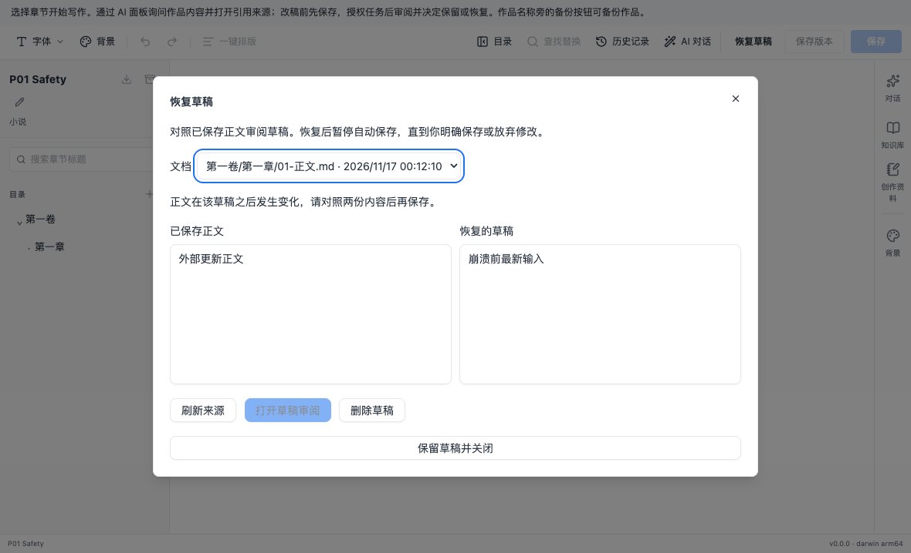
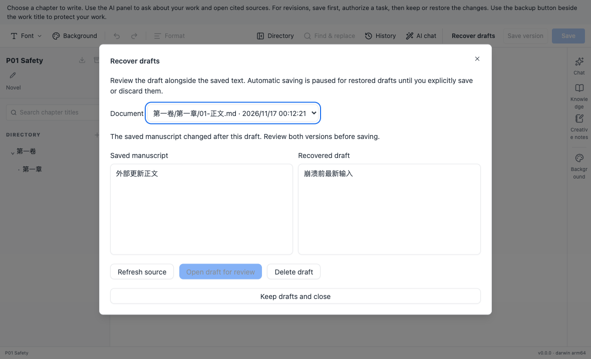
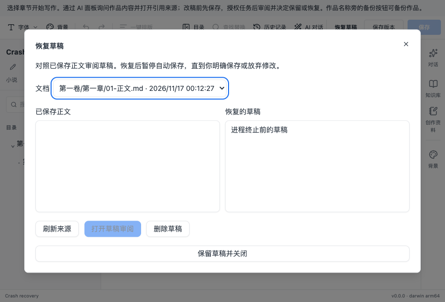
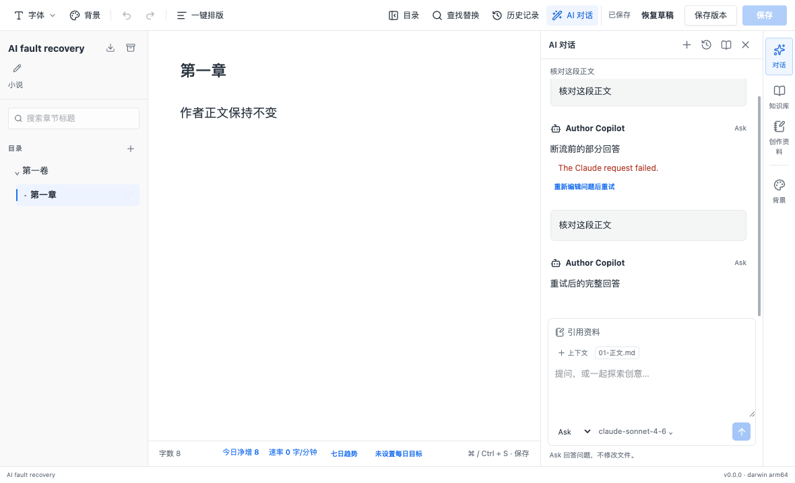

# P0.1 创作安全与发布收口交付

开发日期：2026-11-16 至 2026-11-17。范围与规则见[创作安全规范](../specs/writing-safety.md)。

## 已实现

- 正文停止输入后自动保存；输入法组合输入、AI 任务、正文冲突和恢复草稿审阅期间暂停。
- 正文草稿由主进程原子写入当前账号的独立运行目录；写入失败可见，较早保存不会删除较新草稿。
- 启动作品时可并列审阅正文和恢复草稿。来源变化有提示，恢复后需明确保存；忽略或丢失来源不会自动删除草稿。
- 作品备份包含正文、结构、创作资产、Skill、Git 提交/分支与正文恢复草稿；新建唯一目录和 SHA-256 清单，复制变化或损坏会阻断恢复。
- 作家中心“从备份恢复”自动识别作品类型，恢复为独立作品并保留原作品。恢复时清理 Git Hook 和外部运行配置。
- AI 断流保留部分回答并标记失败，支持取回原问题后手动重试。修复刷新前队列中的对话保存丢失，以及排队写入跨账号目录的风险；退出时等待持久化收尾。
- 首次使用引导说明导入、AI 连接、前文来源与改稿审阅，并说明 AI 内容传输和计费条件。
- 发布材料脚本生成 CycloneDX SBOM、第三方声明和待审核清单，打包自动包含。四架构 CI 增加 E2E 与显式签名/公证检查路径。
- 修复本机 macOS 打包时 Git 2.55 默认尝试调用未安装 cargo 的问题：使用固定源码 Makefile 明确支持的 `NO_RUST=YesPlease`，选择 C 实现。

## 验证记录

定向 Electron 场景已验证中英文自动保存、输入法组合输入、外部变更冲突、草稿审阅、完整备份及从首页恢复；另验证强制终止 Electron 后重启恢复、模型断流后刷新保留部分回答及明确重试。

存储测试验证重启、旧修订清理、磁盘写入失败保留旧草稿、丢失来源、损坏备份拒绝、人物资料和 Skill、Git 提交/分支和恢复草稿。协议测试验证草稿/备份 IPC 归属、路径及负载限制，传输测试覆盖断流与 402/429/503 不自动重试。

2026-11-17 最终 `pnpm verify` 返回 0：

- 格式、模块边界、全仓 lint、类型检查、构建通过；保留既有 4 条 Fast Refresh warning。
- Desktop 316 项通过，真实付费模型专项 2 项按默认配置跳过；Contracts 63 项通过。
- API 4 项通过，MongoDB/Redis 集成专项 8 项按默认配置跳过。
- Electron 39 项通过、依赖平台服务的专项 1 项跳过，包含新增的 4 个安全流程场景。
- 本机 darwin-arm64 Git 2.55.0 运行时校验、生产服务与网络安全专项通过。
- 未签名 macOS arm64 应用启动检查输出 `AUTHOR_COPILOT_ELECTRON_SMOKE_READY`。

完整记录：`/tmp/author-copilot-p01-final-verify.log`、`/tmp/author-copilot-p01-final-smoke.log`、`/tmp/author-copilot-p01-final-package.log`。

本机打包使用已安装的同版本 Electron 分发目录避免重复下载：`pnpm --filter @author-copilot/desktop exec electron-builder --mac zip --arm64 --config.electronDist=node_modules/electron/dist`。该命令已返回 0。开发包为 `apps/desktop/release/Author Copilot-0.0.0-arm64-mac.zip`，已检查包含内置 Git、SBOM、第三方声明及解包的 Agent 运行时，并启动包内应用通过 smoke。该开发包不代表签名发布；DMG 生成还需单独完成。

## 界面证据

## 发布边界

当前没有配置真实付费模型验收密钥和模型，专项尚未运行。没有完成四架构签名安装包的完整验收，也没有生成已签名、公证通过的正式发布物。

本机材料工具列出 8 项许可证待审核，包括仓库未确定应用分发许可证。材料报告不会自动消除这些待办，不擅自为应用选择许可证。

备份范围是作品及正文草稿，账户凭据、对话、写作统计、索引和 AI 运行时快照不包含在内。未决 AI 任务必须先审阅处理。详见规范中的范围、容量与恢复限制。
